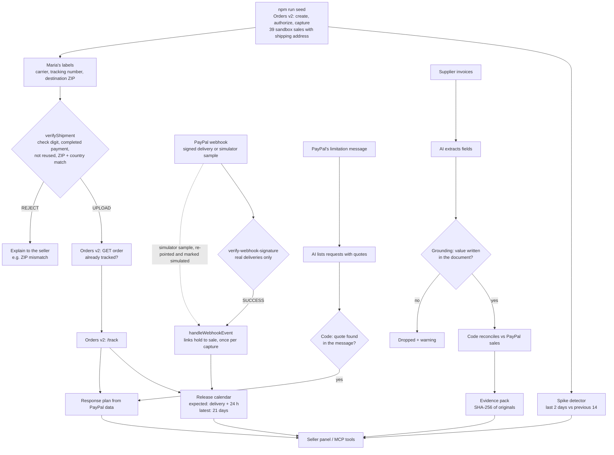

# Architecture

SpikeReady is a small TypeScript codebase. Pure functions make the decisions; thin modules talk to PayPal and Claude; the scripts, the HTTP server and the MCP server all reuse the same modules. **The AI reads and explains; the code decides** and is the only part that calls PayPal.

## Modules

| Path | Role |
|---|---|
| `src/config.ts` | Loads environment variables (or a git-ignored `.env`), validates them with Zod, names missing variables without printing values |
| `src/domain.ts` | Data model (sale, shipment, tracking upload, hold) and money helpers (integer cents) |
| `src/store.ts` | Local JSON state in `.spikeready/` (git-ignored), atomic writes |
| `src/paypal/client.ts` | OAuth, JSON requests, `PayPal-Request-Id` idempotency keys, retries on 429/5xx, token refresh on 401, call receipts with `PayPal-Debug-Id` |
| `src/paypal/orders.ts` | Orders v2: create, authorize, capture, get orders, add tracking |
| `src/paypal/webhooks.ts` | Webhook envelope schema and the webhook simulator |
| `src/paypal/reporting.ts` | Transaction Search (paged) and Balances |
| `src/tracking/` | Tracking-number check digits (`numbers.ts`), the upload rule: completed payment, valid number, not reused, country and ZIP match the buyer's PayPal address (`verify.ts`), and verify → check the order on PayPal → upload (`upload.ts`) |
| `src/holds/` | Reads hold webhooks into a `Hold` and links it to a sale (`event.ts`), handles events once per capture (`handler.ts`), re-points simulator samples to sandbox sales, marked as simulated (`simulator.ts`) |
| `src/release/` | PayPal's hold rules with their sources (`policy.ts`) and the release forecast: expected date and latest (21-day) date per hold, grouped by day in the seller's time zone (`calendar.ts`) |
| `src/spike/detector.ts` | Daily totals, spike rule and readiness checklist |
| `src/ai/` | Claude client for the Anthropic API or the Astropods AI Gateway (`client.ts`), price table (`pricing.ts`) and append-only AI audit log: model, tokens, cost, latency, input hash, never content (`log.ts`) |
| `src/invoices/` | Invoice engine: AI extraction per document (`extract.ts`), grounding of every extracted value in the source text (`grounding.ts`), SHA-256 fingerprints and duplicate files (`integrity.ts`), deterministic reconciliation against PayPal sales (`reconcile.ts`), the pipeline (`pipeline.ts`) and the evidence pack (`dossier.ts`) |
| `src/limitation/` | Limitation notice reader: AI lists PayPal's requests with quotes (`extract.ts`), code keeps only quotes found in the message (`ground.ts`) and builds the response plan from PayPal data (`plan.ts`) |
| `src/server/` | HTTP server: dashboard API, PayPal webhook endpoint with signature verification (`verify-webhook.ts`), invoice and notice routes, recorded demo with a frozen clock (`recorded.ts`), static panel in `web/` |
| `src/mcp/` | MCP server for AI assistants: 8 tools over the same modules; only `upload_tracking` writes, and only with the seller's confirmation and an operator switch |
| `src/disputes/` | Item-not-received dispute evidence: parses `CUSTOMER.DISPUTE.*` events and links them to sales (`event.ts`), rates the evidence from verified tracking as strong, partial or weak (`evidence.ts`), and builds PayPal's `provide-evidence` request, sent only with explicit confirmation (`submit.ts`). Built and tested with PayPal's simulator; a real sandbox dispute end to end is in progress |
| `src/demo/` | Deterministic demo data (Maria's catalog, buyers, labels, baseline history) and the resumable seed helpers |
| `eval/` | Invoice benchmark: generated cases with ground truth, arms (rules, oracle, pipeline, single call), prompt-injection cases, deterministic scoring, reports in `eval/results/` |
| `scripts/` | `check`, `seed`, `approve` (sandbox only), `tracking`, `hold`, `report`, `transactions`, `proof`, `invoices`, `serve`, `mcp`, `register-webhook`, `record-demo`, `eval` (via `npm run …`) |

## Demo chain

## Principles

- Decisions are pure functions with tests; I/O lives at the edges.
- PayPal is the source of truth: before adding tracking, the order is read to avoid duplicates even if local state is lost.
- Every PayPal write has a deterministic idempotency key, so retries are safe.
- The AI only extracts or quotes; every value it returns is validated with Zod and, for text, grounded in the source before code uses it.
- Webhooks are processed only after PayPal verifies their signature.
