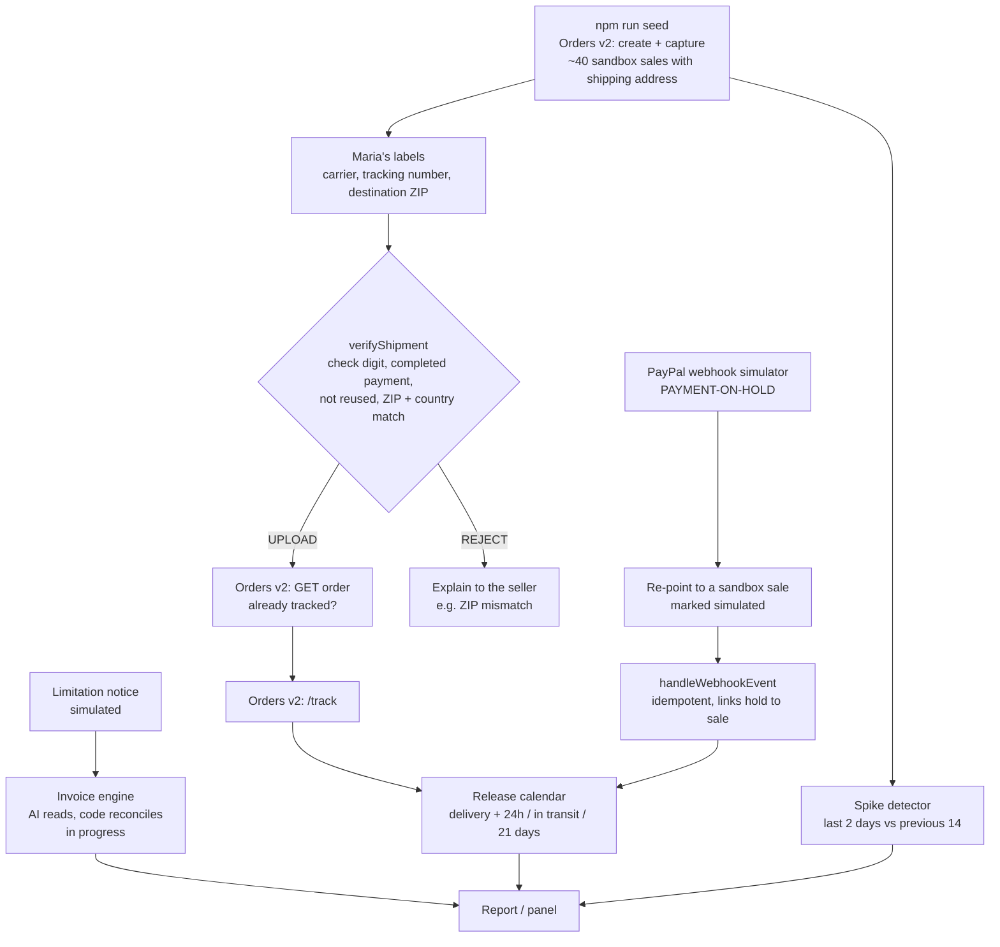

# Architecture

SpikeReady is a small TypeScript codebase. Pure functions make the decisions; thin modules talk to PayPal; scripts wire them together. The day-3 server and panel reuse the same modules.

## Modules

| Path | Role |
|---|---|
| `src/config.ts` | Loads environment variables (or a git-ignored `.env`), validates them with Zod, names missing variables without printing values |
| `src/domain.ts` | Data model (sale, shipment, tracking upload, hold) and money helpers (integer cents) |
| `src/store.ts` | Local JSON state in `.spikeready/` (git-ignored), atomic writes |
| `src/paypal/client.ts` | OAuth, JSON requests, `PayPal-Request-Id` idempotency keys, retries on 429/5xx, token refresh on 401 |
| `src/paypal/orders.ts` | Orders v2: build/create/capture/get orders, add tracking |
| `src/paypal/webhooks.ts` | Webhook envelope schema and the webhook simulator |
| `src/paypal/reporting.ts` | Transaction Search (paged) and Balances |
| `src/tracking/numbers.ts` | Tracking-number format and check digits (USPS, UPS; FedEx by shape) |
| `src/tracking/verify.ts` | The upload rule: completed payment, valid number, not reused, country and ZIP match the buyer's PayPal address |
| `src/tracking/upload.ts` | Verify → check the order on PayPal → upload |
| `src/holds/event.ts` | Reads hold webhooks into a `Hold` and links it to a sale (capture id, then order id) |
| `src/holds/handler.ts` | Webhook handling shared by scripts and the endpoint; idempotent by event id |
| `src/holds/simulator.ts` | Re-points a simulator sample to a sandbox sale, marked as simulated |
| `src/release/policy.ts` | PayPal's hold rules in one place (21 days max, ~24 h after delivery) |
| `src/release/calendar.ts` | Release forecast per hold and a calendar grouped by day in the seller's time zone |
| `src/spike/detector.ts` | Daily totals, spike rule and readiness checklist |
| `src/demo/maria.ts` | Deterministic demo data: Maria's catalog, buyers, labels and baseline history |
| `scripts/*` | `check-env`, `seed-maria`, `upload-tracking`, `simulate-hold`, `report`, `check-transactions` |
| *in progress* | Invoice engine (AI extraction + code reconciliation + integrity checks), case file, HTTP server with webhook signature verification, seller panel |

## Demo chain

## Principles
- Decisions are pure functions with tests; I/O lives at the edges.
- PayPal is the source of truth: before adding tracking, the order is read to avoid duplicates even if local state is lost.
- Every PayPal write has a deterministic idempotency key, so retries are safe.
